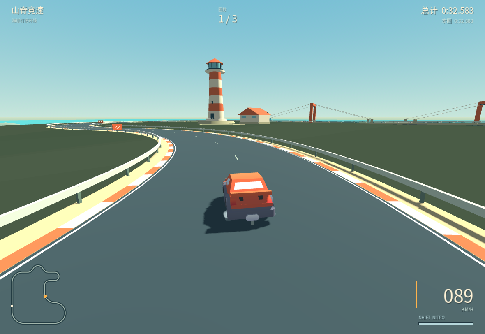

# 山脊竞速 · RIDGELINE

一个 Godot 4.x 原生 3D low-poly 街机赛车原型：驾驶橙色跑车，在 **1,650 米的海崖灯塔环线完成三圈计时挑战**。

单人计时赛，无 AI 对手、无联网功能。重点是清晰的赛道、轻快可控的驾驶和完整的开始—比赛—结算流程，而不是拟真车辆模拟。



## 运行

1. 使用 **Godot 4.7.2** 打开 `project.godot`（本项目实测版本）。
2. 首次打开等待模型与字体导入完成。
3. 按 **F5** 运行主场景，点击「开始驾驶」或按 Enter。

使用 Compatibility / OpenGL 渲染器，无外部插件、依赖安装或下载步骤。也可直接运行：

```sh
godot --path .
```

代码采用 Godot 4.x API，但未宣称所有早期 4.x 版本均已验证。源码仓库不包含引擎二进制、导出包或 `.godot` 导入缓存。

## 操作

| 按键 | 功能 |
|---|---|
| W / ↑ | 加速 |
| S / ↓ | 刹车；接近停止后继续按住会倒车 |
| A D / ← → | 左右转向 |
| Space | 漂移 / Drift：有速度时配合转向按住，出现蓝 / 橙火花后松开触发小涡轮 |
| Shift | 氮气 / Nitro：按住消耗氮气加速，松开后自动回充 |
| R | 返回最近一个有效检查点，计时继续 |
| Esc | 暂停 / 继续；暂停菜单可重新开始 |
| Enter | 从标题或结算界面开始新一局 |

### 漂移与氮气

- **入弯 → 按住 Space → 松开出弯**：车速约 43 km/h 以上，配合 A / D 进入漂移。方向在入弯时锁定；继续向弯内转向可收紧路线，反打可放宽路线，不会突然反向甩尾。先减速入弯，再用油门带出。
- **蓝火花 → 橙火花**：有效路面弯中行驶约 0.75 / 1.55 秒后升级；松开 Space 分别获得 0.65 / 1.15 秒小涡轮，以及少量氮气补充。火花就是蓄力提示，不额外占用仪表面积。
- **Shift 独立氮气**：右下角四格细条是容量，一瓶约能持续 4 秒。松开 0.8 秒后开始回充，约 10 秒补满；耗尽后一直按住不会反复触发。需要向前行驶并加油门，倒车、空中或草地不触发。
- **不能刷蓄力**：原地、倒车、草地、近乎直线的完全反打都不能蓄力；刹车、离地、撞墙或复位会清掉漂移奖励，需松开再按 Space 入漂。漂移与氮气共用 54 m/s（约 194 km/h）的加速上限，不叠加无限速度。
- **R 不补氮气**，只回到最近有效检查点并清掉当前漂移 / 小涡轮，计时继续。只有重新开始整场比赛才补满。暂停同时冻结计时、车辆和资源。

高速转弯请先松油门或刹车；驶上路肩会减速。护栏限制驶出赛道。复位不跳过检查点，也不补发圈数。

这是一套受卡丁车竞速游戏（包括《马里奥赛车》）启发的**原创街机机制**，不是对某一代游戏物理或数值的精确复刻；不使用其角色、道具、美术、音效或品牌素材。

## 海崖灯塔环线

**港湾起步 → 礁岸 S → 船坞发卡 → 灯塔长漂 → 防波堤冲刺 → 归港末弯。** 六区的宽度、转角和出口空间都为现有漂移 / 氮气设计，不是给旧环道换装饰。港仓、吊机、船坞、灯塔和跨水海桥构成可辨识的世界地标。没有必跳或必须满氮气才能通过的路段。

赛道设计、一手案例及其具体影响见 [docs/TRACK_DESIGN.md](docs/TRACK_DESIGN.md)。新赛道最佳成绩与旧晴岭记录分开保存。

## 当前内容

- 手工分区的闭合柏油赛道、连续路面/路肩碰撞、变宽道路、双色路肩、厚护栏、制动预告与明确起终点。
- 实际导入的 Kenney 跑车 GLB，独立转向/旋转车轮、视觉车身侧倾。
- 自写 `CharacterBody3D` 街机控制器：加速、刹车、倒车、速度相关转向、抓地恢复、可控漂移、分级小涡轮、独立氮气及草地阻力。
- 轮边漂移烟雾、蓝 / 橙火花、短尾焰；轻微加速视野变化与边缘速度线。
- 跟随镜头、速度相关视野、前方观察与障碍遮挡检测。
- 三秒起步倒计时；18 个有序、单向检查门；单圈/总计时、三圈结算和重新开始。
- 本地三圈最佳成绩保存在 `user://records.cfg`。QA 驾驶脚本不会写入成绩。
- 简洁中文 HUD、赛道小地图、暂停菜单和原创合成引擎声。

## 验证

```sh
# 导入 + 规则与真实物理测试（使用隔离的临时 user:// 目录）
GODOT_BIN=/path/to/godot tests/run_tests.sh

# 真正通过加速/刹车/转向 Input action 驾驶三圈，不移动坐标、不改圈数
/path/to/godot --headless --path . --fixed-fps 60 --script res://tests/drive_laps.gd

# 使用同一正常输入驾驶器验证漂移 → 小涡轮 → 氮气，完整三圈
/path/to/godot --headless --path . --fixed-fps 60 --script res://tests/drive_laps.gd -- --kart

# 有可用桌面时，保存真实渲染的标题、漂移、氮气、结算及短动画帧
/path/to/godot --path . --script res://tests/drive_laps.gd -- --kart --capture-dir=/absolute/output/path
```

测试范围和实际结果见 [docs/TESTING.md](docs/TESTING.md)。脚本测试不等于所有 GPU/操作系统的硬件兼容性测试。云端原生画面在 Mesa llvmpipe 软件渲染器上验证；其帧率不代表用户独立 GPU 表现。

## 结构

- `scripts/arcade_car.gd`：车辆物理和模型动画。
- `scripts/kart_effects.gd`：轻量原创粒子与低多边形尾焰。
- `scripts/lighthouse_layout.gd`：六区手工 Bezier 控制点、变宽及检查门数据。
- `scripts/track_world.gd`：共享采样的赛道、碰撞、护栏与路牌。
- `scripts/harbor_scenery.gd`：原创建模的海岸、港口、灯塔与桥。
- `scripts/race_rules.gd`：与画面解耦的计圈规则。
- `scripts/main.gd`：比赛流程、镜头及本地纪录。
- `scripts/race_hud.gd`：中文界面。
- `tests/`：针对性测试和正常输入驾驶验证。

## 美术、参考与许可

先研究 Godot 官方车辆/角色文档，以及 Truck Town、Godot Recipes、Godot Easy Vehicle Physics，再编写本项目的小型街机控制器；没有直接导入大型车辆框架。外观参考 low-poly 公路赛车的清晰轮廓和克制 UI。

程序代码 MIT；Kenney 模型/贴图 CC0；重命名 Noto Sans CJK 字体子集 SIL OFL 1.1。详见 [ASSET_CREDITS.md](ASSET_CREDITS.md) 与各资源目录的许可证。
