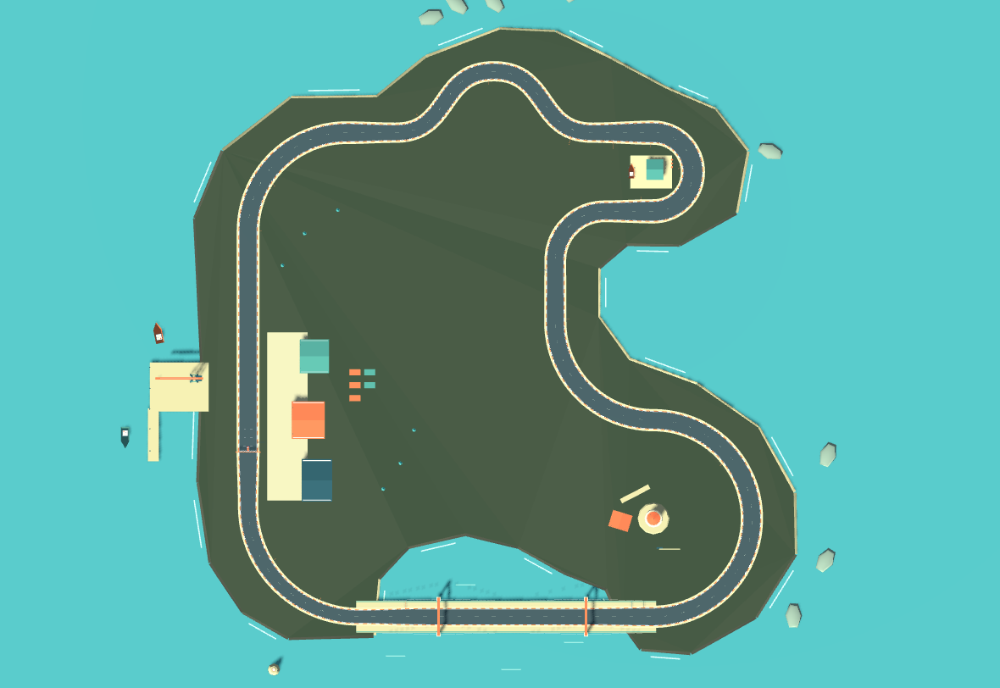

# 海崖灯塔环线 · Lighthouse Circuit

一条 **1,650 m、6 区、18 个有序单向门**的原创海岸计时赛道。不是旧赛道换皮：手工 Bezier 路段明确安排起步、连续换向、制动、长漂、冲刺和收尾。普通驾驶验证约 65 秒/圈；使用漂移与氮气约 53–55 秒/圈，均不是玩家成绩承诺。

## 一圈的设计

| 区段 / 距起点 | 几何与可见地标 | 玩家要做的决定 |
|---|---|---|
| 01 港湾出发 / 0–346 m | 180 m 起步直道、R80 迎宾弯；宽 14.4 m，渐收至 12.4 m。港仓、吊机、起终门架。 | 先熟悉车速；宽弯可保守走线，也可尝试第一段漂移。 |
| 02 礁岸节奏 / 346–544 m | 两个反向 S 节拍，总长 199 m，50 m 横向变化；宽 12.4 m。开阔海面与礁石保持视线。 | 提前为下一个方向换位，不在连续反向中盲目一直按 Space。 |
| 03 船坞发卡 / 544–798 m | 50 m 回正制动直道 → R32 的 180° 右发卡 → 展开回正；最宽 15.6 m。内侧船坞与上架船体。 | 在 100 / 50 预告后减速；晚入弯换取出弯空间，不能用氮气硬顶。 |
| 04 灯塔长弧 / 798–1,225 m | 50 m 恢复段、宽缓左弧，接 **R80、180° 右长弧**；宽 14 m。43 m 条纹灯塔是长期目标。 | 左右切换后稳定漂移蓄到橙火花；弯道展开时释放小涡轮，把出口速度带入桥面。 |
| 05 防波堤冲刺 / 1,225–1,465 m | **240 m 平桥**跨真实水湾；前 55 m 从 14 m 平滑收至 12.6 m，末 55 m 再收至 10.4 m。桥架给出远处目标。 | 把长弧奖励接入 Shift 氮气；可选择何时松开，不能把所有资源留到末弯。没有必需速度门槛。 |
| 06 归港末弯 / 1,465–1,650 m | 完全可见的 R90 右弯；10.4 m 入口渐宽，44 m 回正后冲线。提前 LIFT 标志、港仓与 START / FINISH 门架。 | 窄内线更短，宽外线更稳；提前抬油或保守制动，争取下一圈的出弯速度。 |

半径、宽度和距离是本项目针对现有控制器的原创调校，不是参考作品的复刻参数。护栏在柏油边缘外 1.8 m；路肩仍可行驶但会减速，连续碰撞避免从海桥跌出。宽度用 smoothstep 过渡，赛道没有跳台、强制捷径或交叉路口。

## 参考如何影响了实现

- **Nadeo 官方 Trackmania Track of the Day 指南**：[可读路线、检查点恢复、避免新手不能稳定通过的强制速度要求](https://doc.trackmania.com/play/what-is-totd/)。因此所有检查点均可静止重新起步，桥不要求满氮气，没有必跳。
- **Nintendo《Mario Kart World》开发者访谈 Part 2**：[弯道与漂移、目的地方向、直道也需要玩法](https://www.nintendo.com/us/whatsnew/ask-the-developer-vol-18-mario-kart-world-part-2/)。因此不是均匀曲率环：紧发卡在长漂之前，长漂直接接可用氮气的海桥，灯塔提前可见。
- **WRC 7 关卡设计师 Benoit Gomes 的设计文章**：[先规划地标，再用有理由的道路连接；路旁场景也改变读路](https://www.gamedeveloper.com/design/racing-level-design-the-rally-case)。因此港口、船坞、灯塔、桥是真正相异的世界地标，而非 HUD 上换名称。
- **Luke McMillan 的赛道分析**：[《A Rational Approach to Racing Game Track Design》](https://www.gamedeveloper.com/design/a-rational-approach-to-racing-game-track-design)，分析《Maximum Tune》Hanshin 与《Initial D》Akina 的弯道进/中/出、视线与宽度节奏。这是作者的分析案例，不冒称两游戏开发者访谈。采用其“弯道出口空间影响下一段”思路，未复制路线或导入图片。

## 工程边界

- `scripts/lighthouse_layout.gd` 是小型手工路段表：控制点、起终宽度、所属区段、检查门标记；不是通用赛道生成器。
- `track_world.gd` 生成 528 个共享中心线采样，驱动路面碰撞、路肩、护栏、小地图、局部路宽、检查点和复位朝向。
- `harbor_scenery.gd` 原创建模港口、海岸、灯塔及桥；现有 Kenney CC0 车与少量树保留。
- 桥与所有路面保持 y = 0.12 m，桥下水面降低；没有伪称新增坡道车辆物理。现有 54 m/s 上限、漂移蓄力及氮气数值均未修改。
- 新纪录单独保存为 `lighthouse_v1`，不拿旧 786 m 晴岭圈速做新赛道最佳成绩。
- 没有新 AI、联网、道具或近路；具体验证与限制见 [TESTING.md](TESTING.md)。
